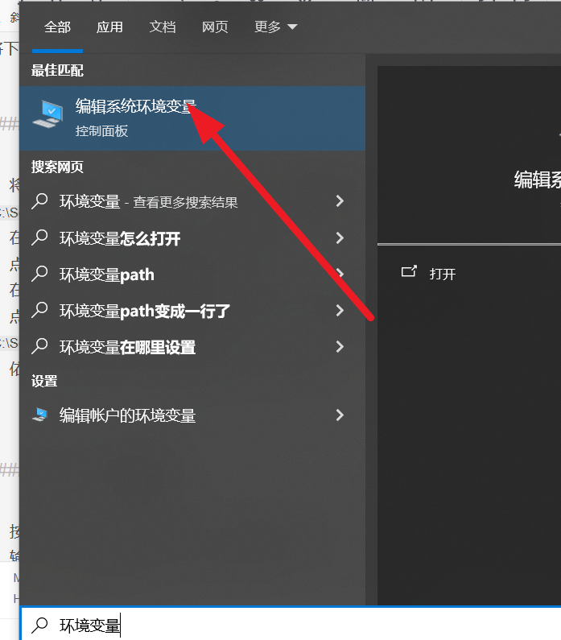

# Selenium's ChromeDriver installation and environment variable configuration under Windows

Okay, installing and configuring Selenium ChromeDriver on Windows is very simple.

Okay, installing and configuring Selenium ChromeDriver under Windows is very simple. Here are the detailed steps, including two methods (the recommended method).

Method 1: Place ChromeDriver directly in the project directory or specified path (recommended for beginners)

This method does not require configuration of system environment variables, making it more flexible to manage. Especially when you need to manage multiple different versions of ChromeDriver at the same time.

Step 1: Install Chrome Browser

Ensure that you have installed the Google Chrome browser.

Open Chrome, click the three dots in the top right corner... -> Settings -> About Chrome.

Please note down your Chrome version (e.g., 128.0.6613.120). This step is very important because the version of ChromeDriver must match the browser version.

Step 2: Download the corresponding version of ChromeDriver.

Open the official download site for ChromeDriver to find the version that matches your chromedriver. If you can't find it, try downloading it from github.com/futureflsl/chromedriver_mirror.

Find the Stable (stable) channel on the page, and find the version that matches your Chrome browser version number completely.

(For example, if your Chrome is 128.0.6613.120, select the driver for 128.0.6613.120).

Click on the corresponding version, expand the list, and download the zip package for Windows32 or win64.

(Usually download win64).

Step 3: Unzip and use ChromeDriver

Unzip the downloaded chromedriver-win64.zip file.

You will receive a folder named chromedriver-win64, containing a file named chromedriver.exe.

Method A (simplest): Simply place the chromedriver.exe file in the root directory of your Python project.

Method B (specified path): You can also place chromedriver.exe in any location you prefer, and then specify its path in the code.

Step 4: Write test code

Create a Python file (e.g., test_selenium.py) and write the following code:

from selenium import webdriver

from selenium.webdriver.chrome.service import Service

# Method A: If chromedriver.exe is located in the project root directory, no environment variables need to be configured, nor do we need to specify a path (recommended approach in Selenium for newer versions).

# service = Service() # Selenium 4 and above recommended to use Service object

# driver = webdriver.Chrome(service=service)

# Method B: If you have placed chromedriver.exe in a different location, specify the path.

# For example: service = Service(r'C:\MyTools\chromedriver.exe')

service = Service(r'Your ChromeDriver.exe's absolute path')

driver = webdriver.Chrome(service=service)

# Open a webpage

driver.get("https://www.baidu.com")

# Printing Web Page Titles

print(driver.title)

# Close the browser

driver.quit()

Run this script, if you can see the browser automatically open and navigate to , and print out the title, it means the configuration is successful!

Method 2: Add ChromeDriver to the system environment variables PATH (traditional method)

This method is configured once, and all projects can be used universally. However, managing multiple versions is quite troublesome.

Step 1 and Step 2

Same as method one: confirm the Chrome version and download the corresponding version of ChromeDriver.

Step 3: Unzip and find ChromeDriver

Unzip the downloaded zip file to obtain the chromedriver.exe file.

Step 4: Configure environment variables

Place chromedriver.exe in a fixed and easily accessible directory, such as C:\SeleniumWebDrivers\.

Search for "Edit System Environment Variables" in the Windows search bar and open it.

Click the Environment Variables (N)... button below.

In the System Variables section, locate and select the variable named Path, then click Edit.

Click "New", then add the path of your ChromeDriver directory (e.g., C:\SeleniumWebDrivers\) into it.

Click the Confirm button for all open windows to save changes.

Step 5: Verification of configuration

Press Win + R, enter cmd to open command prompt.

Enter the command `chromedriver --version` and press Enter.

If the configuration is successful, it will display the version of the installed ChromeDriver.

C:\Users\YourName>chromedriver --version

ChromeDriver 128.0.6613.120 (fc87b67c9c6c...)

Step 6: Write test code

Now you can use webdriver.Chrome() directly in your code without specifying the path of the Service object, because the system already knows where to find this file.

from selenium import webdriver

# After configuring the environment variables, you can write like this.

driver = webdriver.Chrome()

driver.get("https://www.baidu.com")

print(driver.title)

driver.quit()

Common problems and solutions

Version mismatch error:

Error Message: This version of ChromeDriver only supports Chrome version XX

Solution: Ensure that the version of Chrome Browser and ChromeDriver are exactly the same. Download the correct version from the new address.

ChromeDriver is blocked by the system:

Phenomenon: When the first run is performed, a pop-up message "Windows has protected your computer" appears on Windows.

Solution: Click "More Information," then select "Keep running." Alternatively, right-click on chromedriver.exe -> Properties -> Check "Unblock" -> Apply.

Error: Unable to find Chrome browser:

Solution: It is usually because Chrome is not installed at the default path. You can specify the absolute path of Chrome in your code.

from selenium import webdriver

from selenium.webdriver.chrome.options import Options

options = Options()

options.binary_location = r"C:\YoursChromeInstallation path\Application\chrome.exe"

driver = webdriver.Chrome(options=options)

For most modern development scenarios, method one is strongly recommended as it is more concise and aligns with best practices in project management.

## Payment

Here is a pay link on Stripe ( https://buy.stripe.com/3cs8yP7sY87d0vu9AB ). Please contact me lonlonago@foxmail.com after funding $89, and I will send you a complete data files , thank you!

